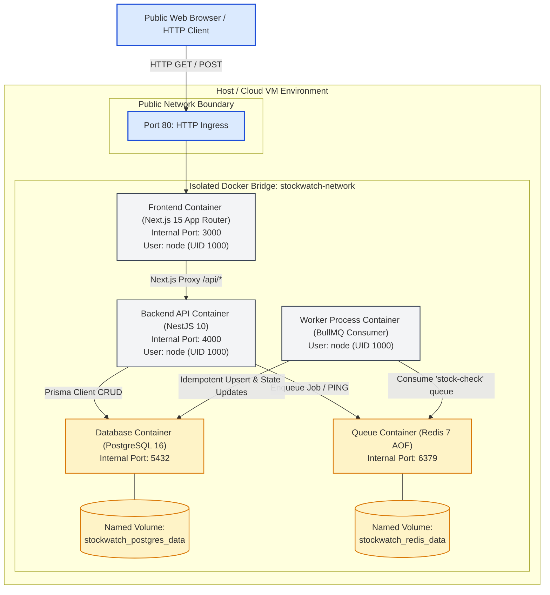
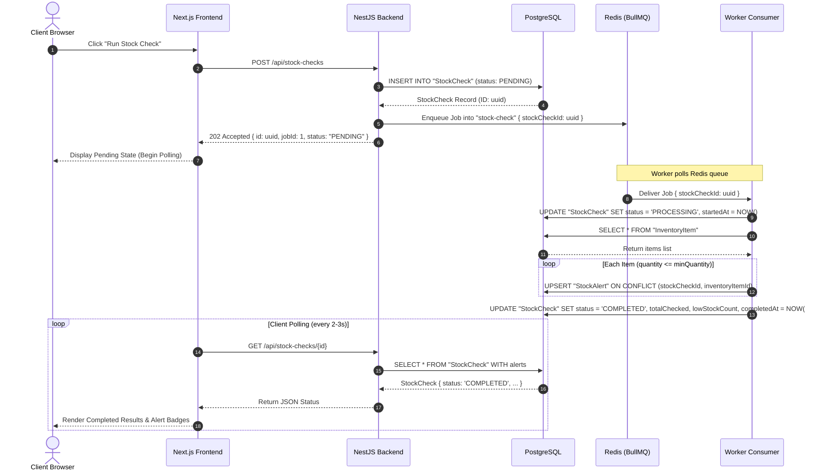

# StockWatch System Architecture & Technical Design

## 1. High-Level Architecture Diagram



---

## 2. Service Responsibilities & Isolation Boundaries

| Service | Runtime Container | Network Exposure | Primary Role |
|---|---|---|---|
| **Frontend** | `stockwatch-frontend` | Public (`80:3000`) | Serves SSR React UI, manages client state, and proxies `/api/*` to internal backend. |
| **Backend** | `stockwatch-backend` | Internal Only (`4000`) | Validates requests, enforces business rules, produces BullMQ jobs, and exposes health probes. |
| **Worker** | `stockwatch-worker` | Internal Only | Consumes background jobs, executes inventory evaluations, and persists alert snapshots. |
| **PostgreSQL** | `stockwatch-postgres` | Internal Only (`5432`) | ACID storage of inventory, stock checks, and alerts. Persists to named Docker volume. |
| **Redis** | `stockwatch-redis` | Internal Only (`6379`) | In-memory message queue broker running with Append-Only File (AOF) persistence. |

---

## 3. Data Flow & Sequence Diagram

The following sequence illustrates an asynchronous stock-check execution:



---

## 4. Key Architectural Safeguards

1. **Idempotent Upsert for Low-Stock Alerts**:
   Worker uses Prisma compound index:
   ```prisma
   @@unique([stockCheckId, inventoryItemId])
   ```
   If a worker process restarts mid-job or BullMQ retries an interrupted task, the alerts are upserted without duplication.

2. **Controlled Failure Simulation**:
   When `WORKER_SIMULATE_FAILURE=true` is injected into the worker container, the processor deliberately transitions the job to `FAILED`, persists the reason in the database, and throws, demonstrating reliability under network or execution failures.

3. **Zero Secrets in Images**:
   Docker multi-stage builds strictly build binaries and discard compile-time build caches. Runtime secrets (such as database credentials and Redis authentication) are supplied exclusively through server-side environment variables (`.env`).
