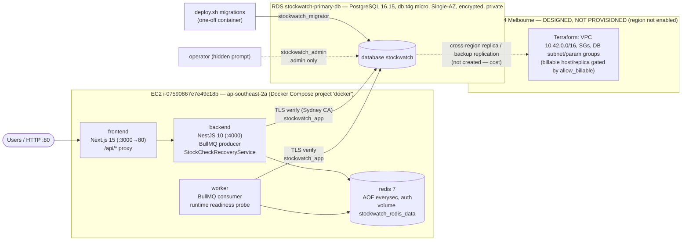

# 02 — System Architecture

## Components

| Component | Role | Recovery-relevant behaviour |
|---|---|---|
| frontend | UI + `/api/*` proxy | container health = end-to-end backend health |
| backend | REST API, enqueues stock checks | `/api/health` (DB + Redis, 3 s timeouts); enqueue persists PENDING row first, then job with **jobId = stock-check id**; `StockCheckRecoveryService` re-enqueues PENDING/PROCESSING checks whose job is missing (60 s interval, 120 s grace) |
| worker | processes jobs | runtime readiness re-checks Redis + DB every 30 s; COMPLETED checks are never recomputed; alerts + COMPLETED committed atomically with `ON CONFLICT DO NOTHING` |
| redis | BullMQ queue | AOF `everysec`; healthcheck requires `PONG` (detects wrong password) |
| RDS | source of truth | private, SG allows 5432 only from the app SG, TLS verify-full |

## Data flow (stock check)

`POST /api/stock-checks` → backend inserts `stock_checks` (PENDING, `jobId = id`) → BullMQ job `id` → worker marks PROCESSING → reads inventory, inserts alerts for low-stock items, marks COMPLETED in one transaction → API returns the record. Production example: job `825a658d-a649-49f4-b70a-231ef3968ddb` (2026-11-11 02:51:03Z, 5 items, 1 alert, completed in 49 ms).

## Database roles

| Account | Use |
|---|---|
| `stockwatch_app` | backend + worker: SELECT/INSERT/UPDATE/DELETE only |
| `stockwatch_migrator` | schema owner; `deploy.sh` migrations; logical backups (run manually) |
| `stockwatch_admin` | RDS master (`rds_superuser`): administrators only |

Details: [04](04-security-and-iam.md), [`docs/database-roles.md`](../database-roles.md).

## Recovery architecture

Primary-environment recovery uses Docker restart policies, `deploy.sh`/`rollback.sh` (target profiles, automatic rollback), verified backups and PostgreSQL-backed queue reconstruction. Regional recovery is designed (Terraform + `dr-failover.sh`/`dr-failback.sh`) and exercised end-to-end only in local simulation — see [07](07-failover-and-failback.md).
